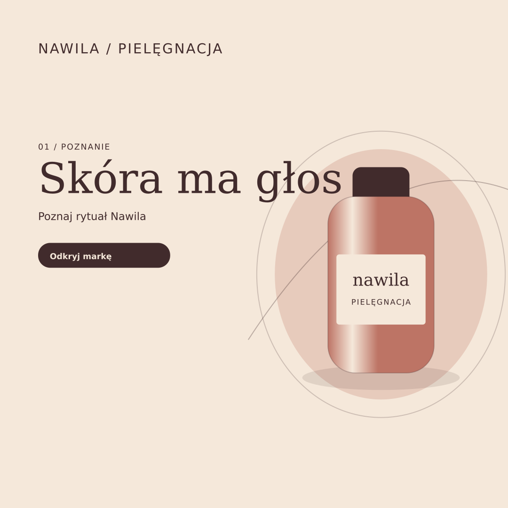

# Nawila · Meta Ads Kit

Projekt koncepcyjny – marka fikcyjna

Zestaw polskojęzycznych kreacji reklamowych i grafik katalogowych dla fikcyjnej marki kosmetycznej Nawila.

## Overview

A portfolio concept for social media advertising and e-commerce catalog work. Ten ads cover awareness, consideration, and conversion. Each is supplied in 1080 × 1080, 1080 × 1350, 1080 × 1920 and 1200 × 628. Six catalog graphics are supplied at 260 × 260.

## Files

- `source/` contains 46 editable SVG originals.
- `exports/` contains the matching PNG and vector PDF exports.
- `index.html` is the responsive Polish gallery with individual downloads.

## Editing

Open any SVG in Inkscape and edit the live text, colors, and product illustrations. The sources use DejaVu Sans and DejaVu Serif. Export the page at its original pixel dimensions for PNG or as PDF for vector output.

## Technology

SVG, HTML, CSS and Inkscape. All illustrations are original vectors. No external photographs are used.
